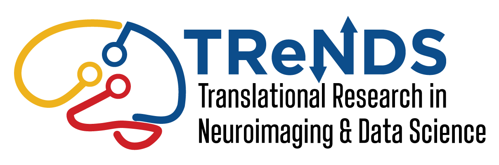
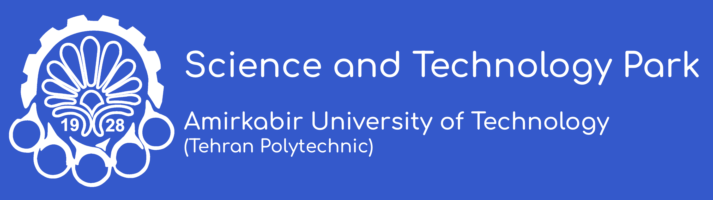
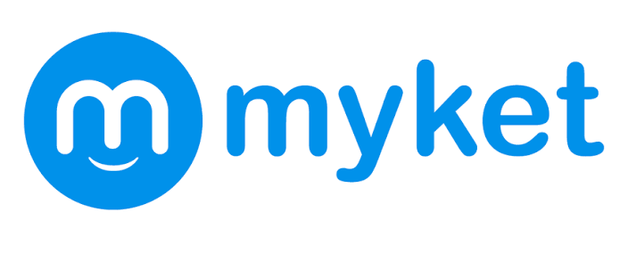
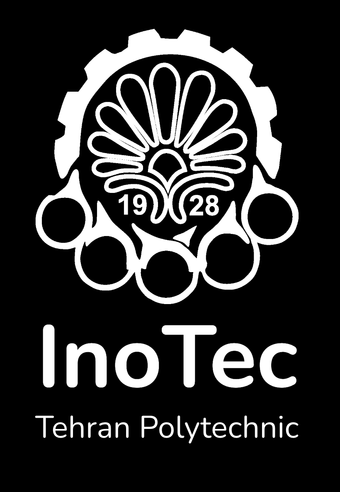

# Professional Experience

Research and industry experience across machine learning, computer vision, data science, backend development, and production ML systems. Additional details are available on [LinkedIn](https://www.linkedin.com/in/amir-sabbaghziarani/).

<article class="work-experience-card">
  

    
Jan. 2025 – Present

    
  

  

    <h2>Graduate Research Assistant</h2>
    
<a href="https://trendscenter.org/">TReNDS Center</a> · Atlanta, GA

    
Joint Georgia Institute of Technology / Georgia State University / Emory University Center for Translational Research in Data Science and Neuroimaging

    
Developing machine-learning and computer-vision systems for 3D reconstruction, structured reasoning, and neuroimaging. Current work includes feed-forward 3D Gaussian Splatting and looped transformer architectures, with controlled evaluation of accuracy, convergence, robustness, and computational efficiency.

    
<strong>Skills:</strong> Python · PyTorch · JAX · Computer Vision · 3D Gaussian Splatting · Transformers · Neuroimaging

  

</article>

<article class="work-experience-card">
  

    
Jan. 2024 – Dec. 2024

    
  

  

    <h2>Data Scientist &amp; Backend Developer</h2>
    
<a href="https://en.wikipedia.org/wiki/Snapp!">Snapp</a> (Iran's largest super app) → Mazrae Startup · Tehran, Iran

    
Built machine-learning models for fertilization analysis and model-driven decision support, then integrated them into production services using FastAPI and Django. Worked with MLflow, Docker, and Kubernetes for experiment tracking and deployment.

    
<strong>Skills:</strong> Python · Machine Learning · FastAPI · Django · MLflow · Docker · Kubernetes

  

</article>

<article class="work-experience-card">
  

    
Jun. 2021 – Mar. 2022

    
  

  

    <h2>Researcher &amp; Developer</h2>
    
<a href="https://amirkabirpark.ir/en/">New Technologies Research Center, Tehran Polytechnic</a> · Tehran, Iran

    
Conducted applied computer-vision research on Industry 4.0 technologies in mining and developed a driver-behavior analysis system for operational safety using Python, PyTorch, and OpenCV.

    
<strong>Skills:</strong> Python · PyTorch · OpenCV · Computer Vision · Industry 4.0

  

</article>

<article class="work-experience-card">
  

    
Mar. 2021 – Aug. 2021

    
  

  

    <h2>Data Science Intern</h2>
    
<a href="https://myket.ir/about?lang=en">Myket International</a> · Dubai, UAE

    
Analyzed large-scale application and user data with Python and SQL, developed predictive machine-learning models, and applied reproducible experiment tracking and evaluation workflows.

    
<strong>Skills:</strong> Python · SQL · PyTorch · Machine Learning · Data Analysis · MLOps

  

</article>

<article class="work-experience-card">
  

    
Sep. 2020 – Jul. 2021

    
  

  

    <h2>Researcher &amp; Developer</h2>
    
<a href="https://inotec.aut.ac.ir/index.php?slc_lang=en&amp;sid=42">InoTec, Tehran Polytechnic</a> · Tehran, Iran

    
Developed a methodology for integrating AI models into real-time automotive ECU systems, with embedded-system prototyping and system-level modeling in SystemC and Linux.

    
<strong>Skills:</strong> SystemC · Linux · Embedded AI · ECU Systems · Real-Time Modeling

  

</article>

