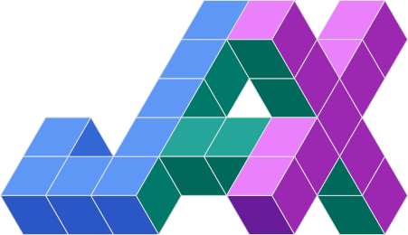
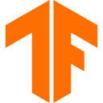
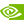
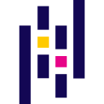

This page highlights selected public GitHub projects, ordered by technical depth and relevance to AI engineering, machine learning, computer vision, NLP, scientific computing, GPU programming, and research software. Systems, web, networking, and software-engineering projects follow after the AI-focused work.

<section class="project-toolkit" aria-labelledby="project-toolkit-title">
  

    <h2 id="project-toolkit-title">Tools used across my projects</h2>
    
Languages, frameworks, and infrastructure I have used in research and software projects.

  

  

    

      <h3>Machine Learning &amp; Vision</h3>
      

        
PyTorch

        
JAX

        
TensorFlow

        
Hugging Face

        
scikit-learn

        
OpenCV

        
CUDA

      

    

    

      <h3>Data &amp; Scientific Computing</h3>
      

        
Python

        
NumPy

        
pandas

        
Jupyter

        
Apache Spark

        
MLflow

      

    

    

      <h3>Deployment &amp; Engineering</h3>
      

        
FastAPI

        
Docker

        
Kubernetes

        
GitHub Actions

        
PostgreSQL

        
C++

      

    

  

</section>

AI, Machine Learning, Computer Vision, NLP, Scientific Computing, and GPU Programming




  

    

      
{{ project.label }}

      
      
      
      <a href="{{ project.project_url }}"></a>
      
      
      
      
    

  

  

    <h2 class="project-entry-title"><a href="{{ project.project_url | default: project.repo }}">{{ project.title }}</a></h2>
    
{{ project.year }} &nbsp;|&nbsp; {{ project.stack }}

    
{{ project.description }}

    
    

      {{ project.venue_status }} <a href="{{ project.venue_url }}">{{ project.venue_name }}</a> (<a href="{{ project.workshop_url }}">{{ project.workshop_name }}</a>) &middot; Acceptance ratio: {{ project.acceptance }} 
      <em>{{ project.date }}</em> &middot; First author 
      Project: <a href="{{ project.project_url }}">Website</a> &middot; Code: <a href="{{ project.repo }}">GitHub</a> &middot; arXiv: <a href="{{ project.arxiv_url }}">{{ project.arxiv_label }}</a> &middot; arXiv: {{ project.arxiv_label }} &middot; <a href="{{ project.openreview_url }}">OpenReview</a> &middot; DOI: <a href="{{ project.doi_url }}">{{ project.doi_label }}</a>
    

    
    
Project: <a href="{{ project.project_url }}">Website</a> &middot; Code: <a href="{{ project.repo }}">GitHub</a>

    
  



Systems, Web, Networking, and Software Engineering




  

    

      
{{ project.label }}

      
      
      
      
    

  

  

    <h2 class="project-entry-title"><a href="{{ project.repo }}">{{ project.title }}</a></h2>
    
{{ project.year }} &nbsp;|&nbsp; {{ project.stack }}

    
{{ project.description }}

  



